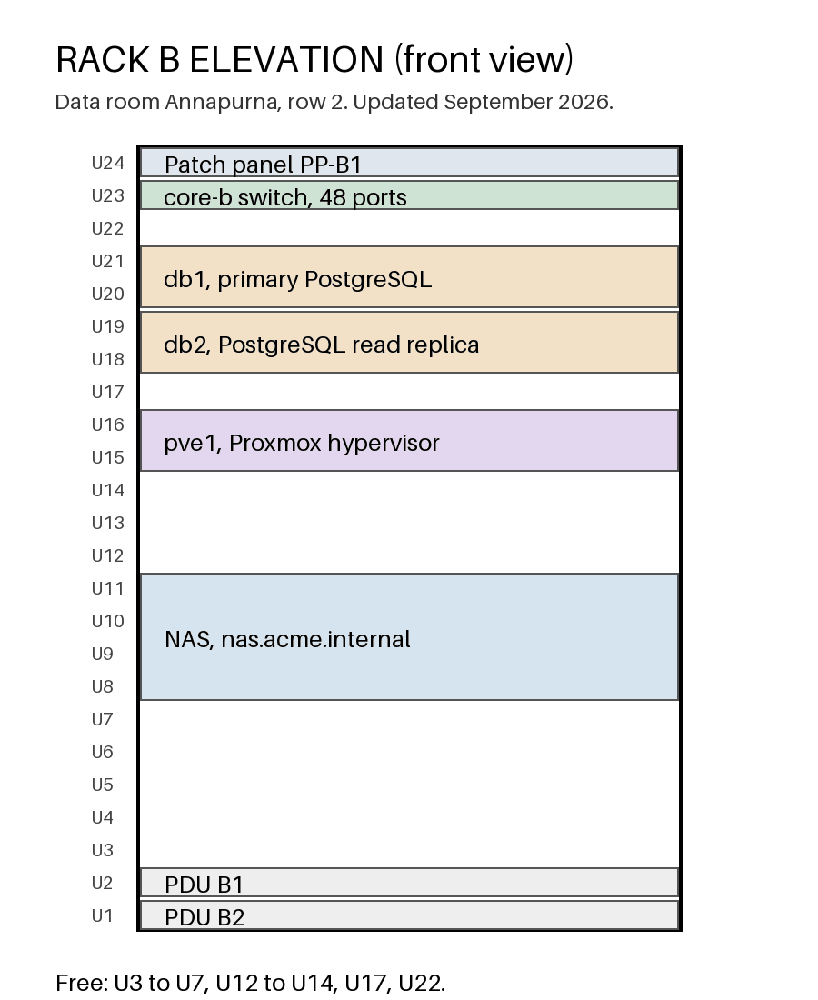

# Servers

| Name | Role | Location |
|---|---|---|
| web1 | public website | rack A |
| web2 | public website (standby) | rack A |
| db1 | primary PostgreSQL | rack B |
| db2 | PostgreSQL read replica | rack B |
| pve1 | [[proxmox]] hypervisor | rack B |

Physical servers are covered by a next-business-day hardware support contract until 2027:
see the [Brightrack contract](documents/brightrack-support-contract.pdf) (PDF), with the
serial numbers in its schedule A.

Every machine, with its asset tag and warranty, is in the
[hardware inventory](documents/hardware-inventory.xlsx) (spreadsheet).

Access goes through the bastion, `bastion.acme.internal`, with your personal SSH key.
